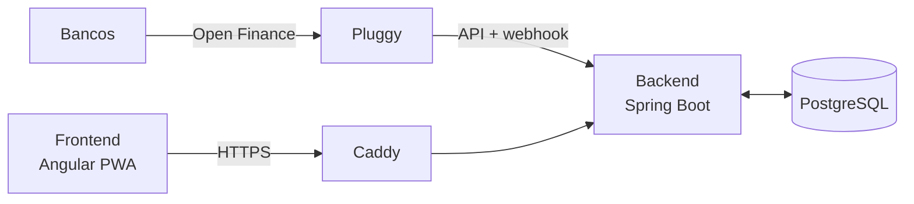

# App de Gastos

Aplicativo para controle de gastos familiares com **Open Finance**. Ele importa automaticamente as compras dos cartões e contas, ajuda a identificar e destinar cada compra para a pessoa certa, fecha o mês com o total de cada pessoa conferido contra as faturas e controla os recebimentos.

> 🚧 **Em desenvolvimento.** Acompanhe o progresso pelo roteiro abaixo e pelas [releases](../../releases).

## O problema

Controlar os gastos de vários cartões (titular e adicionais) usados por pessoas diferentes da família exige preencher uma planilha à mão todo mês: conferir cada compra no app do banco, descobrir de quem foi, dividir o que é compartilhado e calcular quanto cada pessoa deve.

## A solução

- **Importação automática** das transações e faturas via Open Finance.
- **Identificação em cascata** de cada compra (CNPJ, estabelecimento, descrição, categoria), com uma legenda que aprende com as correções.
- **Destino por pessoa**, a partir do cartão usado, de regras e de ajustes manuais.
- **Divisões** de compras, eventos e contas fixas entre várias pessoas.
- **Fechamento mensal** com conferência automática contra o total oficial das faturas.
- **Controle de recebimentos**, com sugestão de Pix e confirmação manual.
- **Acesso por perfil:** o administrador vê tudo; cada membro vê só o que é dele.

## Como funciona



1. Os bancos compartilham os dados (somente leitura) pelo Open Finance, através da Pluggy.
2. O backend sincroniza as contas, os cartões, as faturas e as transações, sem duplicar nada.
3. Cada lançamento é classificado (compra, estorno, pagamento de fatura, tarifa, transferência própria, recebimento), e o que não é gasto sai dos totais.
4. A **legenda em cascata** dá nome, categoria e dono às compras, por CNPJ, estabelecimento, descrição ou MCC.
5. O dono que a legenda não define vem do **cartão** usado (ou da conta).
6. O que ficou sem dono ou sem nome vai para a **caixa de entrada**, onde é resolvido com um clique, valendo para todas as parcelas.
7. Compras podem ser **divididas** entre várias pessoas (iguais, por valor ou por percentual), sem perder um centavo, inclusive por regras e em eventos.
8. As **contas fixas** (água, luz, financiamento) são geradas todo mês, com o rateio de cada uma, e o pagamento é encontrado sozinho no extrato.
9. O **fechamento do mês** junta cartões, conta corrente e contas fixas no total de cada pessoa, confere cada fatura contra o total oficial do banco e, quando publicado, vira uma foto congelada.
10. Os **recebimentos** mostram quem já pagou o mês, com os Pix recebidos sugeridos pelo nome no extrato.

Toda decisão automática guarda a sua origem (banco, regra, cartão), e uma **edição manual nunca é sobrescrita**.

Mais detalhes em [Arquitetura e decisões](docs/arquitetura.md).

## Stack

| Camada | Tecnologias |
|---|---|
| Backend | Java 21, Spring Boot 4, Spring Data JPA, PostgreSQL 17, Flyway |
| Testes | JUnit 5, AssertJ |
| Planilhas | Apache POI |
| Frontend | Angular (PWA), Tailwind CSS |
| Integração | Open Finance via Pluggy |
| Infra | Docker, Docker Compose, Caddy, GitHub Actions, VPS Linux |

## Como rodar localmente

### Pré-requisitos

- Java 21
- Docker e Docker Compose
- Uma aplicação na [Pluggy](https://dashboard.pluggy.ai) com os bancos conectados

### Passo a passo

1. Clone o repositório e entre na pasta:

   ```bash
   git clone https://github.com/AlisonSantos-dev/app-gastos.git
   cd app-gastos
   ```

2. Crie o arquivo de variáveis de ambiente a partir do modelo e preencha os valores (senha do banco, credenciais e ids dos bancos na Pluggy):

   ```bash
   cp .env.example .env
   ```

   > No Windows (PowerShell): `Copy-Item .env.example .env`

3. Suba o banco de dados:

   ```bash
   docker compose up -d
   ```

4. Rode a API:

   ```bash
   cd backend
   ./mvnw spring-boot:run
   ```

   > No Windows (PowerShell): `.\mvnw spring-boot:run`

5. Confira se está tudo no ar em [http://localhost:8080/actuator/health](http://localhost:8080/actuator/health).

6. Faça a primeira sincronização:

   ```bash
   curl -X POST http://localhost:8080/api/sync
   ```

> Se a porta `5432` já estiver em uso na sua máquina, troque o valor de `DB_PORT` no `.env`.

### Testes

```bash
cd backend
./mvnw test
```

## Endpoints

| Método | Caminho | O que faz |
|---|---|---|
| `POST` | `/api/sync` | Sincroniza contas, cartões, faturas e transações com a Pluggy |
| `POST` | `/api/classificacao/reclassificar` | Reaplica as regras de classificação (preserva as manuais) |
| `GET` | `/api/contas` | Contas com os seus cartões |
| `GET` | `/api/faturas?contaId=` | Faturas de um cartão, conciliadas com o total oficial |
| `GET` | `/api/transacoes` | Transações com filtros e paginação |
| `PATCH` | `/api/transacoes/{id}` | Edição manual (descrição, categoria, dono, classificação), propagada às parcelas |
| `GET` `POST` `PUT` `DELETE` | `/api/pessoas` | Cadastro de pessoas |
| `GET` `PUT` | `/api/cartoes` | Configuração dos cartões (dono fixo ou compartilhado) |
| `PUT` | `/api/contas/{id}` | Nome e dono padrão das contas |
| `GET` `POST` `PUT` `DELETE` | `/api/regras` | Regras da legenda |
| `POST` | `/api/legenda/reaplicar` | Reaplica a legenda e mostra a cobertura |
| `GET` | `/api/legenda/pendentes` | Descrições sem regra mais frequentes |
| `GET` `POST` | `/api/caixa` | Caixa de entrada: listar, escolher o dono, confirmar |
| `POST` | `/api/importacao/planilha` | Importa a planilha antiga e sugere regras |
| `GET` `POST` | `/api/importacao/sugestoes` | Aprovar ou descartar as sugestões |
| `PUT` `DELETE` | `/api/transacoes/{id}/divisao` | Divide uma compra entre pessoas (ou desfaz) |
| `GET` `POST` `PUT` `DELETE` | `/api/divisoes-salvas` | Modelos de divisão (ex.: "Spotify Família") |
| `POST` | `/api/divisoes/lote` | Divide várias compras de uma vez (eventos) |
| `GET` `POST` `PUT` `DELETE` | `/api/contas-fixas` | Cadastro das contas fixas |
| `GET` `POST` | `/api/contas-fixas/competencias/{mês}` | As contas do mês: gerar e procurar os pagamentos no extrato |
| `GET` | `/api/fechamentos/{mês}` | O fechamento do mês (prévia ou publicado), com a conferência das faturas |
| `POST` `DELETE` | `/api/fechamentos/{mês}/publicar` | Publica (congela) ou reabre o mês |
| `GET` `POST` `DELETE` | `/api/recebimentos` | Quem já pagou o mês e as sugestões de Pix recebidos |
| `GET` | `/api/pluggy/status` | Status da conexão com a Pluggy |

Filtros de `/api/transacoes`: `contaId`, `cartao`, `faturaId`, `tipo`, `somenteGastos`, `de`, `ate`, `texto`, `pagina` e `tamanho`.

## Estrutura do repositório

```
app-gastos/
├── backend/             # API em Spring Boot
├── frontend/            # App em Angular (PWA)
├── docs/                # Arquitetura, decisões e especificações
├── docker-compose.yml   # Banco de dados para desenvolvimento
└── .env.example         # Modelo das variáveis de ambiente
```

## Roteiro

- [x] **Fase 0:** Fundação (repositório, projeto e ambiente local)
- [x] **Fase 1:** Modelo de dados e integração com o Open Finance · `v0.1.0`
- [x] **Fase 2:** Identificação das compras · `v0.2.0`
- [x] **Fase 3:** Divisões, contas fixas e fechamento do mês · `v0.3.0`
- [ ] **Fase 4:** Usuários, perfis e segurança · `v0.4.0`
- [ ] **Fase 5:** Frontend em Angular · `v0.5.0`
- [ ] **Fase 6:** Automação e deploy · `v1.0.0`
- [ ] **Fase 7:** Dashboard · `v1.1.0`
- [ ] **Fase 8:** MCP e recursos de IA · `v1.2.0`

## Privacidade

Este repositório não contém dados reais. Todos os exemplos usam dados fictícios, e as credenciais ficam fora do controle de versão. Dados de terceiros presentes nos pagamentos (documento e conta bancária) não são armazenados.
