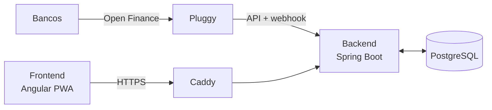

# App de Gastos

Aplicativo para controle de gastos familiares com **Open Finance**. Ele importa automaticamente as compras dos cartões e contas, ajuda a identificar e destinar cada compra para a pessoa certa, fecha o mês com o total de cada pessoa conferido contra as faturas e controla os recebimentos.

> 🚧 **Em desenvolvimento.** Acompanhe o progresso pelo roteiro abaixo e pelas [releases](../../releases).

## O problema

Controlar os gastos de vários cartões (titular e adicionais) usados por pessoas diferentes da família exige preencher uma planilha à mão todo mês: conferir cada compra no app do banco, descobrir de quem foi, dividir o que é compartilhado e calcular quanto cada pessoa deve.

## A solução

- **Importação automática** das transações e faturas via Open Finance.
- **Identificação em cascata** de cada compra (CNPJ, estabelecimento, descrição, categoria), com uma legenda que aprende com as correções.
- **Destino por pessoa**, a partir do cartão usado, de regras e de ajustes manuais.
- **Divisões** de compras, eventos e contas fixas entre várias pessoas.
- **Fechamento mensal** com conferência automática contra o total oficial das faturas.
- **Controle de recebimentos**, com sugestão de Pix e confirmação manual.
- **Acesso por perfil:** o administrador vê tudo; cada membro vê só o que é dele.

## Como funciona



1. Os bancos compartilham os dados (somente leitura) pelo Open Finance, através da Pluggy.
2. O backend sincroniza as transações e faturas todos os dias e também recebe um aviso (webhook) quando há transações novas.
3. Cada compra passa pela identificação em cascata e recebe uma descrição e um destino.
4. O administrador revisa o que não foi identificado, publica o fechamento do mês e confirma os recebimentos.
5. Cada membro da família acessa o app e vê só os seus gastos.

Mais detalhes em [Arquitetura e decisões](docs/arquitetura.md).

## Stack

| Camada | Tecnologias |
|---|---|
| Backend | Java 21, Spring Boot 4, Spring Data JPA, Spring Security, PostgreSQL 17, Flyway |
| Frontend | Angular (PWA), Tailwind CSS |
| Integração | Open Finance via Pluggy |
| Infra | Docker, Docker Compose, Caddy, GitHub Actions, VPS Linux |

## Como rodar localmente

### Pré-requisitos

- Java 21
- Docker e Docker Compose

### Passo a passo

1. Clone o repositório e entre na pasta:

   ```bash
   git clone https://github.com/AlisonSantos-dev/app-gastos.git
   cd app-gastos
   ```

2. Crie o arquivo de variáveis de ambiente a partir do modelo e defina uma senha para o banco:

   ```bash
   cp .env.example .env
   ```

   > No Windows (PowerShell): `Copy-Item .env.example .env`

3. Suba o banco de dados:

   ```bash
   docker compose up -d
   ```

4. Rode a API:

   ```bash
   cd backend
   ./mvnw spring-boot:run
   ```

   > No Windows (PowerShell): `.\mvnw spring-boot:run`

5. Confira se está tudo no ar em [http://localhost:8080/actuator/health](http://localhost:8080/actuator/health). O status deve ser `UP`, inclusive o do banco (`db`).

> Se a porta `5432` já estiver em uso na sua máquina, troque o valor de `DB_PORT` no `.env`.

## Estrutura do repositório

```
app-gastos/
├── backend/             # API em Spring Boot
├── frontend/            # App em Angular (PWA)
├── docs/                # Arquitetura, decisões e especificações
├── docker-compose.yml   # Banco de dados para desenvolvimento
└── .env.example         # Modelo das variáveis de ambiente
```

## Roteiro

- [x] **Fase 0:** Fundação (repositório, projeto e ambiente local)
- [ ] **Fase 1:** Modelo de dados e integração com o Open Finance · `v0.1.0`
- [ ] **Fase 2:** Identificação das compras · `v0.2.0`
- [ ] **Fase 3:** Divisões, contas fixas e fechamento do mês · `v0.3.0`
- [ ] **Fase 4:** Usuários, perfis e segurança · `v0.4.0`
- [ ] **Fase 5:** Frontend em Angular · `v0.5.0`
- [ ] **Fase 6:** Automação e deploy · `v1.0.0`
- [ ] **Fase 7:** Dashboard · `v1.1.0`
- [ ] **Fase 8:** MCP e recursos de IA · `v1.2.0`

## Privacidade

Este repositório não contém dados reais. Todos os exemplos usam dados fictícios, e as credenciais ficam fora do controle de versão.