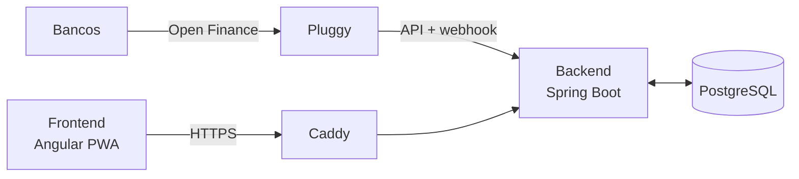

# Arquitetura e decisões

Este documento registra a visão geral do sistema e as principais decisões técnicas. Ele é atualizado a cada fase.

## Visão geral

## Integração com o Open Finance

- O acesso aos dados bancários é feito pela **Pluggy**, que agrega os dados do Open Finance Brasil.
- O consentimento é **somente leitura**: o sistema não consegue movimentar dinheiro.
- Os dados são atualizados uma vez por dia. O backend sincroniza por agendamento e também recebe um webhook quando há transações novas.
- Endpoints usados: autenticação, contas, transações (paginação por cursor) e faturas de cartão.

### Particularidades tratadas na sincronização

- Cada compra de cartão traz o **final do cartão** usado, o que permite separar titular e adicionais.
- Compras parceladas trazem o número da parcela e o total de parcelas, mas não o valor total, que é calculado.
- A fatura de cada compra é definida pelo identificador da fatura, quando fechada, ou pela data de fechamento, quando aberta.
- Pagamentos de fatura e transferências entre contas próprias são classificados à parte e **não entram nos gastos**.
- Estornos de centavos (ajustes de arredondamento de parcelas) são tratados como estornos normais.
- Dados de terceiros presentes nas transferências (como documento e conta bancária) são **descartados antes de salvar**.

## Principais regras de negócio

### Identificação das compras (cascata)

Cada compra tem a descrição original do banco e uma descrição amigável. A descrição amigável é definida pela primeira regra que se aplicar, nesta ordem:

1. Edição manual
2. CNPJ do estabelecimento
3. Nome do estabelecimento
4. Descrição exata
5. Descrição que contém um trecho
6. Categoria do estabelecimento (MCC), que define só a categoria
7. Sem identificação: vai para a caixa de entrada para revisão

### Destino das compras

O destino (para quem é a compra) segue a mesma lógica de prioridade: o **cartão** define o padrão, as **regras** refinam, as **regras temporárias** valem no período delas e a **edição manual** tem a palavra final. Uma edição manual vale só para aquela compra, exceto entre as parcelas da mesma compra.

### Fechamento do mês

- A competência de um mês é formada pelas faturas que vencem nele.
- O total destinado a cada pessoa é conferido contra o total oficial das faturas.
- Os membros só veem um mês depois que ele é publicado pelo administrador.
- Recebimentos são sugeridos a partir das transferências recebidas, mas só são confirmados manualmente.

## Stack

| Camada | Tecnologias |
|---|---|
| Backend | Java, Spring Boot (Web, Data JPA, Validation, Security), PostgreSQL, Flyway |
| Frontend | Angular (PWA), Tailwind CSS |
| Infra | Docker Compose, Caddy (HTTPS automático), VPS Linux, GitHub Actions |

## Segurança e privacidade

- Acesso ao servidor somente por chave SSH, sem login de root e sem senha.
- Firewall com apenas as portas necessárias abertas; o banco de dados nunca é exposto.
- Segredos em variáveis de ambiente, fora do controle de versão.
- Senhas de usuários armazenadas com hash.
- Filtro de dados por pessoa sempre aplicado no backend.
- Somente os 4 últimos dígitos dos cartões são armazenados.

## Fluxo de trabalho

- Uma branch e um Pull Request por etapa.
- Commits no padrão [Conventional Commits](https://www.conventionalcommits.org/pt-br/) (`feat:`, `fix:`, `chore:`, `docs:`, `test:`, `refactor:`).
- Uma tag de versão e uma release ao final de cada fase.